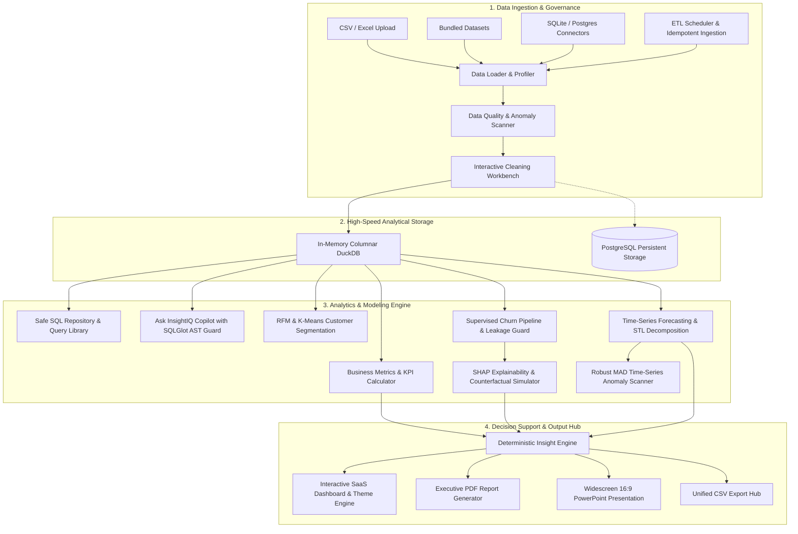

# InsightIQ • AI-Powered Business Intelligence & Decision Support Platform

[](https://www.python.org/)
[](https://streamlit.io/)
[](https://duckdb.org/)
[](https://scikit-learn.org/)
[](https://github.com/tobymao/sqlglot)
[]()
[]()
[]()

> **InsightIQ** is an AI-powered Business Intelligence (BI) and Predictive Decision Support platform demonstrating end-to-end capabilities across data governance, SQL engineering, machine learning, explainable AI, natural-language analytics, and executive reporting.

---

## App Link: https://1insightiq.streamlit.app/
## 🏗️ Architecture Overview



---

## ✨ Flagship Capabilities & Modules

### 1. 🤖 Ask InsightIQ Conversational Copilot

- **Natural-Language Analytics:** Supports plain-language questions such as "Which category generated the highest profit?", "Top 5 products by revenue", and "Monthly revenue trend".
- **AST-Based SQL Security:** Uses SQLGlot to parse queries into an abstract syntax tree, enforce read-only execution, restrict multi-statement queries, and apply row limits.
- **Deterministic Fallback:** Supports offline query generation without requiring an external paid API key.
- **Automatic Visualization:** Recommends Plotly charts, including time-series lines, category bars, donut charts, and scatter plots.

### 2. 🧠 Explainable AI (SHAP) & Counterfactual Analysis

- **SHAP Attribution:** Explains global feature importance and individual predictions using Shapley values.
- **Customer Risk Investigation:** Displays risk tiers, probability scores, feature contributions, and diagnostic summaries.
- **Counterfactual Simulator:** Explores potential interventions while protecting immutable identifiers and unsuitable features.
- **Non-Causal Disclosures:** Distinguishes model sensitivity from proven real-world causation.

### 3. 🌊 Time-Series Forecasting & Anomaly Detection

- **STL Decomposition:** Separates time-series data into trend, seasonal patterns, and residual noise.
- **Model Benchmarking:** Evaluates forecasting approaches such as Naive, Moving Average, Holt's Linear Trend, Seasonal Naive, and Holt-Winters.
- **Sequential Backtesting:** Evaluates forecasts chronologically to reduce future-data leakage.
- **Robust Anomaly Detection:** Uses rolling medians and Median Absolute Deviation (MAD) to identify unusual surges and contractions.

### 4. 📊 Executive PowerPoint & PDF Reporting

- **PowerPoint Generation:** Creates widescreen 16:9 presentations containing executive summaries, KPI dashboards, strategic priorities, and methodology notes.
- **PDF Reporting:** Generates printable reports with tables, data-quality findings, and business recommendations.
- **CSV Exports:** Supports exporting analytical results for further investigation.

### 5. 🔌 Data Connectors & ETL

- **Database Connectors:** Provides a unified interface for SQLite, DuckDB, and PostgreSQL, alongside cloud warehouse integration stubs.
- **Scheduled Ingestion:** Demonstrates batch ingestion, execution tracking, row-count checks, data-quality grading, and retry logging.
- **Data Governance:** Supports data profiling, quality validation, cleaning, and anomaly checks.

---

## 📐 Mathematical Methodologies

### 1. Robust Time-Series Anomaly Score

$begin:math:display$
MAD \= \\operatorname\{median\}\(\|y\_t \- \\operatorname\{median\}\(y\)\|\)
$end:math:display$

$begin:math:display$
z\_t \= \\frac\{y\_t \- \\text\{rolling median\}\}\{1\.4826 \\times MAD\}
$end:math:display$

### 2. Time-Series Prediction Intervals

$begin:math:display$
Lower\_\{95\\\%\} \= \\max\(0\, \\hat\{y\}\_\{t\+h\} \- 1\.96 \\cdot \\sigma\_e \\sqrt\{h\}\)
$end:math:display$

$begin:math:display$
Upper\_\{95\\\%\} \= \\hat\{y\}\_\{t\+h\} \+ 1\.96 \\cdot \\sigma\_e \\sqrt\{h\}
$end:math:display$

### 3. Weighted Absolute Percentage Error (WAPE)

$begin:math:display$
WAPE \= \\frac\{\\sum\_\{t\=1\}\^\{n\}\|y\_t\-\\hat\{y\}\_t\|\}\{\\sum\_\{t\=1\}\^\{n\}\|y\_t\|\}\\times100\\\%
$end:math:display$

---

## 🚀 Quick Start & Installation

### Option 1: Local Python Environment

Clone the repository and enter the project directory:

```bash
git clone https://github.com/rajputsidhu/InsightIQ.git
cd InsightIQ
```

Create and activate a virtual environment:

```bash
python3 -m venv venv
source venv/bin/activate
```

On Windows, activate it using:

```bash
venv\Scripts\activate
```

Install dependencies:

```bash
pip install -r requirements.txt
```

Run the test suite:

```bash
PYTHONPATH=. pytest -p no:asyncio -v
```

Launch the application:

```bash
streamlit run app.py
```

### Option 2: Docker

Build and start the application:

```bash
docker-compose up --build
```

Open the application in your browser at:

http://localhost:8501

---

## 🧪 Automated Testing

InsightIQ includes tests for data governance, SQL safety, machine learning, explainability, forecasting, conversational analytics, and reporting.

Run the tests with:

```bash
PYTHONPATH=. pytest -p no:asyncio -v
```

The project's original test documentation reports 47 passing tests. Run the command above to verify the current results in your environment.

---

## 🔒 Security & Data Integrity

1. **SQL Validation:** SQL queries are validated before execution to restrict unsafe operations and enforce read-only behavior.
2. **Leakage Prevention:** Predictive features should exclude identifiers and information that would reveal future outcomes.
3. **Temporal Validation:** Forecasting evaluation preserves chronological ordering.
4. **Explainability:** Feature importance and counterfactual outputs are model-based explanations, not guarantees of real-world causation.
5. **Credential Protection:** Store secrets in environment variables and never commit actual credentials or private API keys.

---

## 🛠️ Technology Stack

- **Language:** Python
- **Application Framework:** Streamlit
- **Analytics & Data Processing:** Pandas, NumPy
- **Database & SQL:** DuckDB, SQLite, PostgreSQL, SQLGlot
- **Machine Learning:** Scikit-learn
- **Explainable AI:** SHAP
- **Visualization:** Plotly
- **Forecasting:** Statistical and time-series modeling
- **Reporting:** ReportLab, python-pptx
- **Deployment:** Docker and Docker Compose
- **Testing:** Pytest

---

## 👨‍💻 Author

**Sidhu Singh**

GitHub: https://github.com/rajputsidhu

---

## 📄 License

This project declares an MIT license in its documentation badge. Add a corresponding `LICENSE` file containing the MIT license text before treating the repository as formally licensed under MIT.
